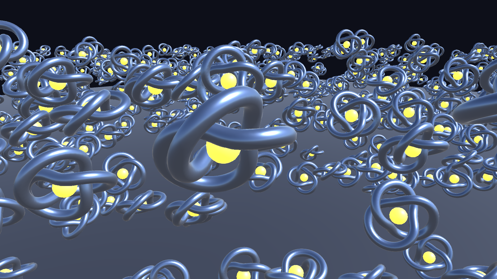

# Unity Jobs: движение по кругу и логарифмы

Практика по Job System в Unity 6000.3.8f1.

- **Часть 1.** При старте спавнится 4000 объектов. Это меш на 2944 треугольника с двумя материалами: металлический узел и светящееся ядро. Объекты движутся по кругу через `IJobParallelForTransform`.
- **Часть 2.** Раз в N = 1 с для каждого объекта считается натуральный логарифм случайного числа от 1 до 100 через `IJob`.

Результаты выводятся в лог или на экран.

**Анализ в Profiler и ответы на вопросы задания: [REPORT.md](REPORT.md).** Готовый PC-билд и записи Profiler лежат в [релизе v1.0](https://github.com/OCAVIT/unity-jobs-practice/releases/tag/v1.0).

## Управление

| Клавиша | Что делает |
|---|---|
| 1 | Движение в `Update` на главном потоке, для сравнения |
| 2 | Движение через `IJobParallelForTransform` |
| 3 | Тот же джоб, но все объекты под одним родителем |
| Q | Вывод результатов: нет, в лог, на экран |
| W | Логарифмы: выключены, `IJob` раз в N с, `IJob` каждый кадр, один `IJobParallelFor` |

## Где код

- `Assets/_Source/OrbitSystem/OrbitJob.cs`: `IJobParallelForTransform`, движение по кругу.
- `Assets/_Source/OrbitSystem/LogJob.cs`: `IJob`, логарифм для одного объекта.
- `Assets/_Source/OrbitSystem/LogBatchJob.cs`: `IJobParallelFor`, те же логарифмы одним джобом для сравнения.
- `Assets/_Source/OrbitSystem/OrbitField.cs`: спавн при старте, запуск и завершение джобов, вывод результатов в лог.
- `Assets/_Source/OrbitSystem/ResultScreen.cs`: вывод результатов на экран.
- `Assets/_Source/Editor`: сборка сцены кодом, автоматическая запись Profiler в редакторе и в билде, разбор кадров и снимки окна Profiler.

Burst не подключён: так в замерах видна цена самой Job System, без ускорения от компилятора.

## Как запустить

**В редакторе.** Откройте сцену `Assets/_Presentation/Scenes/OrbitPlace.unity`, окно `Window > Analysis > Profiler` и нажмите Play.

**PC-билд с Profiler.** Соберите билд командой `Profiler Lab > 2. Собрать PC-билд (Development)` или скачайте его из релиза. Запустите `JobsPractice.exe` и выберите его в списке целей Profiler рядом с кнопкой записи.

**Все замеры автоматически.** Команда `Profiler Lab > 3. Записать все замеры` проходит 10 режимов в Play Mode и в билде, это около 5 минут. Результаты появятся в папках `docs/data` и `docs/screenshots`.
