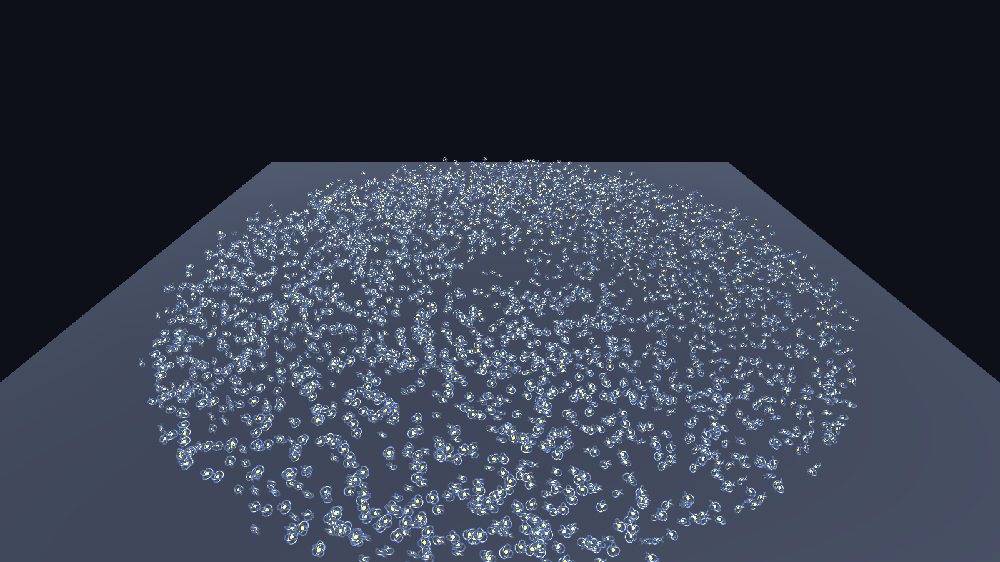
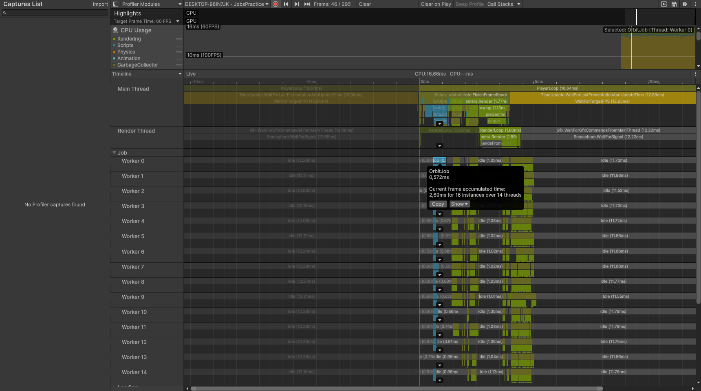
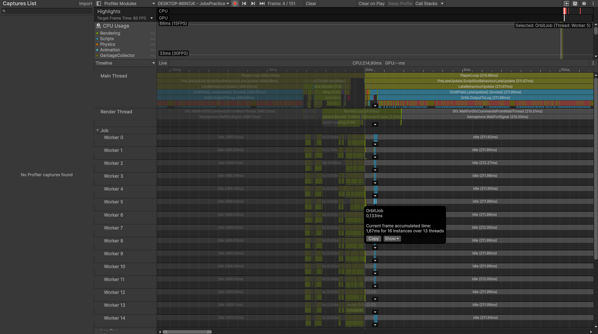
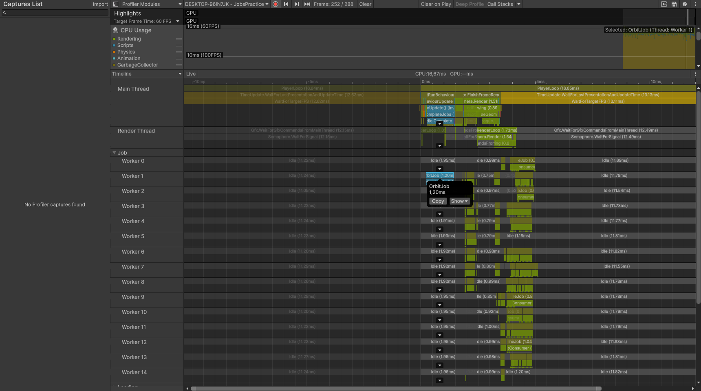
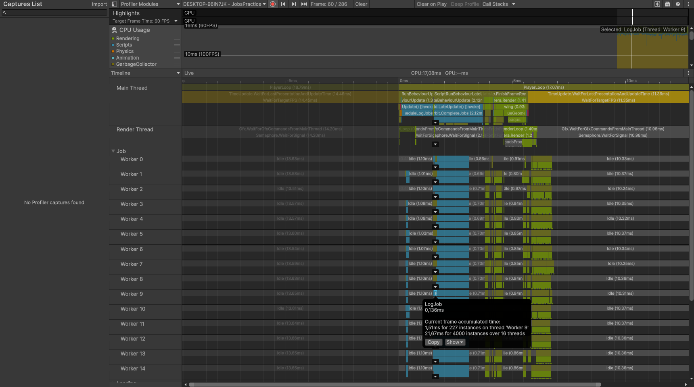
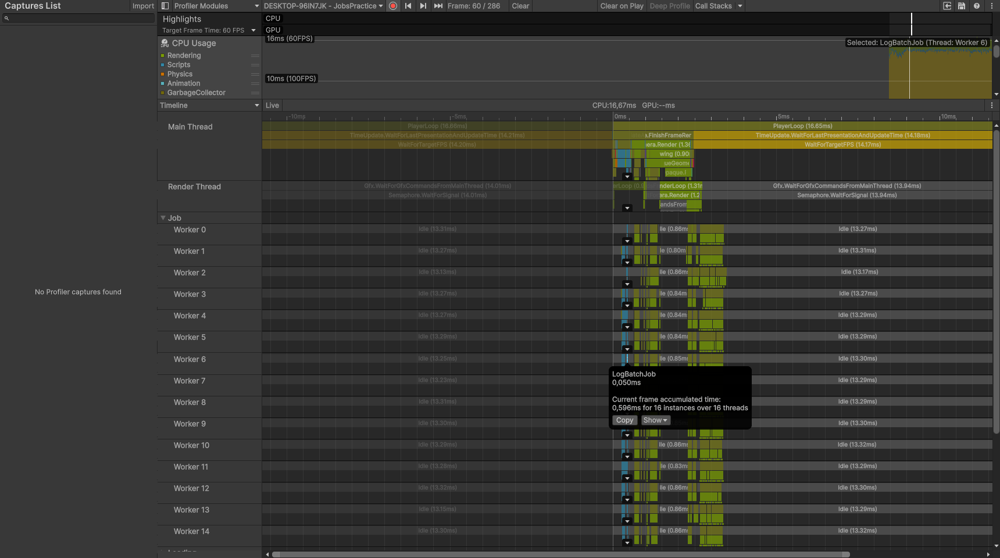

# Job System: анализ в Unity Profiler

## Что сделано

- **Спавн при старте.** 4000 объектов появляются в `Awake`. Меш на 2944 треугольника с двумя материалами: металлический узел и светящееся ядро. Включён GPU Instancing.
- **Часть 1.** Движение по кругу через `OrbitJob : IJobParallelForTransform`. Джоб запускается в `Update`, а завершается в `LateUpdate`.
- **Часть 2.** Раз в N = 1 с для каждого объекта запускается `LogJob : IJob`, он считает натуральный логарифм случайного числа от 1 до 100.
- **Вывод результатов.** В лог пишется `Debug.Log` на каждый результат. На экран выводится панель с первыми 40 строками и сводкой по всем объектам.
- **Для сравнения.** Записаны ещё четыре режима: движение на главном потоке, все объекты под одним родителем, `IJob` каждый кадр и тот же расчёт одним `IJobParallelFor`.

## Как проводился замер

- **Где:** Unity Profiler в Play Mode и в Development-билде (Mono, Direct3D 12). К билду Profiler подключён из редактора, на снимках в шапке окна виден `DESKTOP-96IN7JK - JobsPractice`.
- **Условия:** лимит 60 FPS без vSync, каждый режим записывается 4,5 с. Первый и последний кадр режима не учитываются: в них режим переключается.
- **Компьютер:** NVIDIA RTX 3060, 16 потоков процессора, Job System даёт 15 рабочих потоков. Burst не подключён, чтобы была видна цена самой Job System.
- **Что считали:**
  - средний и минимальный FPS;
  - время своего кода на главном потоке, то есть маркеров `Orbit.*`: движение, запуск и завершение джобов, вывод;
  - для джоба: на скольких рабочих потоках он шёл в кадре, сколько процессорного времени занял суммарно и сколько длился по часам от начала до конца.

Пока FPS упирается в лимит 60, разницу между режимами показывают миллисекунды, а не FPS.

### PC-билд

| Режим | FPS сред. / мин. | Свой код на главном потоке, мс: сред. (макс.) | Джоб: потоков в кадре, суммарно мс, по часам мс |
|---|---:|---:|---|
| Движение на главном потоке | 59,8 / 57,8 | 0,86 (2,0) | нет |
| Часть 1: `IJobParallelForTransform` | 59,7 / 57,8 | 0,35 (0,9) | 12,9; 1,73; 0,20 |
| Часть 1 + вывод в лог | **2,9 / 2,0** | **336 (489)** | 13,3; 1,52; 0,20 |
| Часть 1 + вывод на экран | 59,8 / 57,4 | 0,62 (1,5) | 12,6; 1,80; 0,21 |
| Часть 1, все под одним родителем | 59,8 / 57,9 | 0,91 (1,2) | **1,0**; 0,92; 0,92 |
| Часть 2: `IJob` раз в 1 с | 59,7 / 58,3 | 0,36 (**3,5**) | 14,2; **14,19**; 1,18 |
| Часть 2 + вывод в лог | **49,0 / 4,3** | 4,26 (**225**) | 15,0; 17,08; 1,34 |
| Часть 2 + вывод на экран | 59,8 / 58,1 | 0,41 (3,3) | 15,0; 15,52; 1,24 |
| Часть 2: `IJob` каждый кадр | 59,6 / 58,1 | **3,62** (8,0) | 15,0; 18,46; 1,49 |
| Часть 2: один `IJobParallelFor` | 59,8 / 57,3 | 0,32 (0,7) | 12,8; **0,34**; 0,03 |

В строках части 2 данные джоба взяты из кадров, где он запускался: раз в секунду, а в режиме «каждый кадр» в каждом кадре.

### Редактор (Play Mode)

| Режим | FPS сред. / мин. | Свой код на главном потоке, мс: сред. (макс.) | Джоб: потоков в кадре, суммарно мс, по часам мс |
|---|---:|---:|---|
| Движение на главном потоке | 59,8 / 35,7 | 1,29 (2,7) | нет |
| Часть 1: `IJobParallelForTransform` | 59,9 / 33,7 | 0,34 (1,3) | 13,9; 1,98; 0,19 |
| Часть 1 + вывод в лог | **4,6 / 4,3** | **208 (229)** | 14,4; 1,89; 0,18 |
| Часть 1 + вывод на экран | 59,9 / 36,1 | 0,61 (1,8) | 13,3; 1,97; 0,21 |
| Часть 1, все под одним родителем | 59,7 / 38,2 | 1,01 (1,8) | **1,0**; 1,01; 1,01 |
| Часть 2: `IJob` раз в 1 с | 60,0 / 37,6 | 0,40 (**5,3**) | 15,0; **18,04**; 1,49 |
| Часть 2 + вывод в лог | **49,1 / 4,7** | 4,21 (**208**) | 15,0; 16,94; 1,41 |
| Часть 2 + вывод на экран | 60,0 / 35,4 | 0,43 (5,4) | 15,0; 18,77; 1,58 |
| Часть 2: `IJob` каждый кадр | 56,8 / 32,1 | **5,98** (13,3) | 14,7; 16,99; 1,46 |
| Часть 2: один `IJobParallelFor` | 59,9 / 33,0 | 0,32 (1,4) | 13,2; **0,33**; 0,03 |

Минимум около 33-38 FPS в редакторе есть во всех режимах, даже без джобов. Это паузы самого редактора: главный поток ждёт рендер-поток. К джобам они не относятся.

## Часть 1: ответы

**Стало ли работать хуже после перехода на Jobs?** Нет, стало лучше.
- Движение 4000 объектов на главном потоке занимало 0,86 мс в билде и 1,29 мс в редакторе.
- С `IJobParallelForTransform` главный поток тратит только 0,35 мс на запуск и завершение джоба. Сама работа уходит на 13 рабочих потоков и заканчивается за 0,2 мс по часам.
- Суммарно процессор тратит больше: 1,73 мс против 0,86, это цена деления работы и запуска джоба. Но это время свободных ядер, а не главного потока.
- FPS в обоих режимах 60, так как упирается в лимит.

**Вывод в лог: изменилось ли качество?** Да, резко хуже.
- FPS падает с 60 до 2,9 в билде и до 4,6 в редакторе, один кадр длится 340-490 мс.
- Сам джоб при этом не изменился: 1,5 мс на 13 потоках.
- Всё время уходит на 4000 вызовов `Debug.Log` за кадр. В Profiler это `LogStringToConsole` и `StackTraceUtility.ExtractStackTrace`, Unity собирает стек вызовов для каждой строки.
- Строки дают 10 МБ мусора на кадр, и в билде сборщик мусора запускался 633 раза за 4,5 с.

**Вывод на экран: изменилось ли качество?** Почти нет: FPS 60, главный поток тратит на 0,27 мс больше, мусора 8 КБ на кадр. На экран выводятся 40 строк и одна сводка, поэтому Canvas перестраивает один текст за кадр.

**Почему так.**
- Вывод результатов нельзя сделать внутри джоба: `Debug.Log` и UI работают только на главном потоке.
- Чтобы прочитать результат, главный поток должен дождаться джоба через `Complete()`. Здесь это дёшево: ожидание `WaitForJobGroupID` около 0,13 мс, так как джоб успевает закончиться раньше `LateUpdate`.
- Значит, качество портит не Job System, а то, сколько и как выводится. Лог на каждый объект каждый кадр съедает весь выигрыш от джобов, а короткий вывод на экран почти ничего не стоит.

**Дополнительно: общий родитель.**
- `IJobParallelForTransform` делит работу по корневым объектам иерархии.
- Когда все 4000 объектов лежат под одним родителем, джоб идёт на одном потоке: 0,92 мс одним куском, остальные потоки простаивают.
- Главный поток ждёт его так же, как считал бы сам (0,91 мс против 0,86 мс), и выигрыш от Jobs пропадает.

## Часть 2: ответы

**Стало ли работать хуже?** Средний FPS не изменился (59,7), но появился скачок раз в секунду.
- Таймеры всех объектов стартуют одновременно, поэтому 4000 `IJob` запускаются в одном кадре.
- В этом кадре главный поток тратит 3,5 мс в билде и 5,3 мс в редакторе вместо обычных 0,36 мс.
- Рабочие потоки тратят 14,2 мс процессорного времени. По часам это 1,2 мс.
- Один логарифм считается за наносекунды, так что 3,5 мкс на каждый `IJob` уходят в основном на создание, планирование и завершение джоба и на выделение `NativeArray` для результата.

**Вывод в лог: изменилось ли качество?** Да.
- Раз в секунду кадр длится около 225 мс.
- Средний FPS падает до 49, а 1% самых медленных кадров идёт со скоростью 4,9 FPS: игра заметно дёргается каждую секунду.
- Причина та же, что в части 1: 4000 вызовов `Debug.Log` в одном кадре на главном потоке и 141 запуск сборщика мусора за сценарий.

**Вывод на экран: изменилось ли качество?** Нет, разница в пределах погрешности: 0,41 мс против 0,36 мс в среднем.

**Почему так.** Job System выгодна, когда работы в джобе много. Логарифм для одного объекта слишком мал, поэтому накладные расходы на джоб в сотни раз больше самой задачи. Это видно по двум дополнительным режимам:
- **`IJob` каждый кадр:** главный поток тратит 3,6 мс за кадр, а рабочие потоки на 23 мс больше, чем без логарифмов. FPS пока держится только потому, что у компьютера 15 свободных потоков. На телефоне с 4-8 ядрами это уже была бы просадка и нагрев.
- **Один `IJobParallelFor` на все объекты:** те же 4000 логарифмов занимают 0,34 мс процессорного времени и 0,03 мс по часам, а главный поток тратит не больше 0,7 мс. Это примерно в 40 раз дешевле, чем 4000 отдельных `IJob`.

## Редактор и билд

- **Скрипты и джобы в билде дешевле:** движение на главном потоке 0,86 мс против 1,29 мс, `OrbitJob` 1,73 мс против 1,98 мс, кадр с 4000 `IJob` 3,5 мс против 5,3 мс. В редакторе работают проверки безопасности Job System, а сам Profiler обрабатывает данные потоков (`Profiler.ParseThreadData` на рабочих потоках).
- **Вывод в лог в билде ещё дороже:** 336 мс за кадр против 208 мс в редакторе, почти всё время уходит в `LogStringToConsole`.

## Итог

1. `IJobParallelForTransform` снимает движение объектов с главного потока и делит его на все ядра. Объекты при этом не должны быть детьми одного родителя.
2. Вывод результатов возвращает работу на главный поток. Лог на каждый объект уничтожает весь выигрыш: FPS падает с 60 до 3-5. Короткий вывод на экран почти бесплатен.
3. `IJob` на крошечную задачу работает хуже простого кода: накладные расходы больше самой задачи. Одновременный запуск тысяч таких джобов даёт скачок раз в N секунд.
4. Однотипные маленькие задачи лучше собирать в один `IJobParallelFor` и разносить таймеры объектов во времени.
